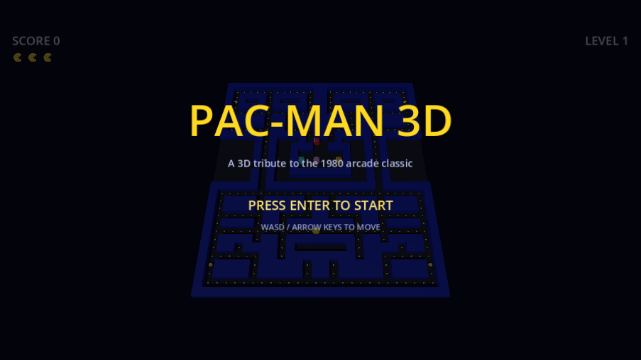
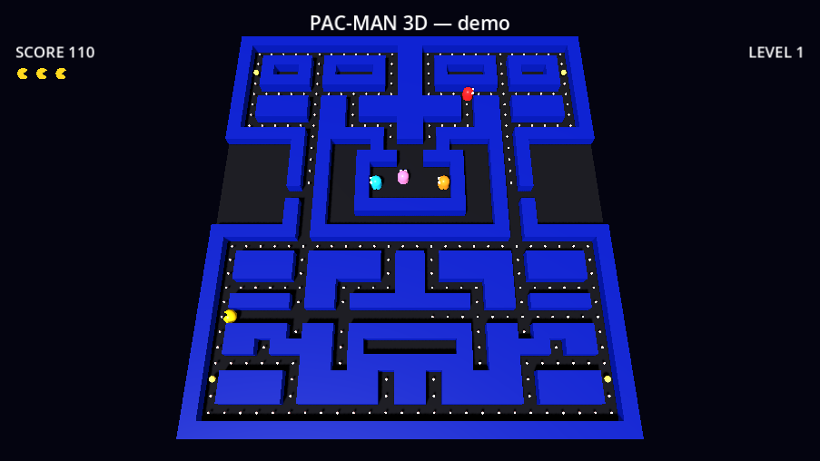
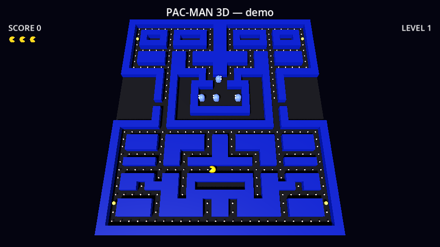

# Pac-Man 3D

[](https://github.com/orbitmechanic/pacman-3d/actions/workflows/ci.yml)

A 3D take on the classic maze chase: munch dots, dodge ghosts, grab power
pellets, flip the hunt — built from scratch in **Godot 4.7** (GDScript, GL
Compatibility renderer). No external assets: the maze, characters, and
effects are procedural geometry and code.



> Fan tribute inspired by Namco's *Pac-Man* (1980). Not affiliated with or
> endorsed by Bandai Namco Entertainment Inc.

## How to play

| Goal | Details |
| --- | --- |
| Start / restart | `Enter` or `Space` |
| Move | `WASD` or arrow keys |
| Eat dots | +10 each; clear the maze to win the level |
| Power pellet | +50; ghosts turn blue and flee — eat them for 200/400/800/1600 |
| Ghost touch | lose a life (3 pucks in the HUD) |
| Level up | each cleared board re-tints the maze and speeds the game up |
| Tunnel | the middle row wraps around both sides |




## Running locally

1. Install [Godot 4.7+](https://godotengine.org/download) (standard build, not .NET).
2. Open this folder as a project in the Godot editor, or run headlessly:

   ```bash
   godot --path .
   ```

## Development

- Architecture and design notes: [docs/ARCHITECTURE.md](docs/ARCHITECTURE.md)
- Contributing workflow (branches, PRs, CI): [CONTRIBUTING.md](CONTRIBUTING.md)
- Testing: everything is validated three ways — engine runs clean headless,
  scripted logic probes in `tests/`, and rendered screenshots. See
  [CONTRIBUTING.md](CONTRIBUTING.md#validation-gates).
- States and dev hooks: [`--demo`, `--state`, `--capture`](CONTRIBUTING.md#validation-gates)
  make every screen reproducible from a clean checkout.

## License

[MIT](LICENSE) for all code and generated content in this repository.
